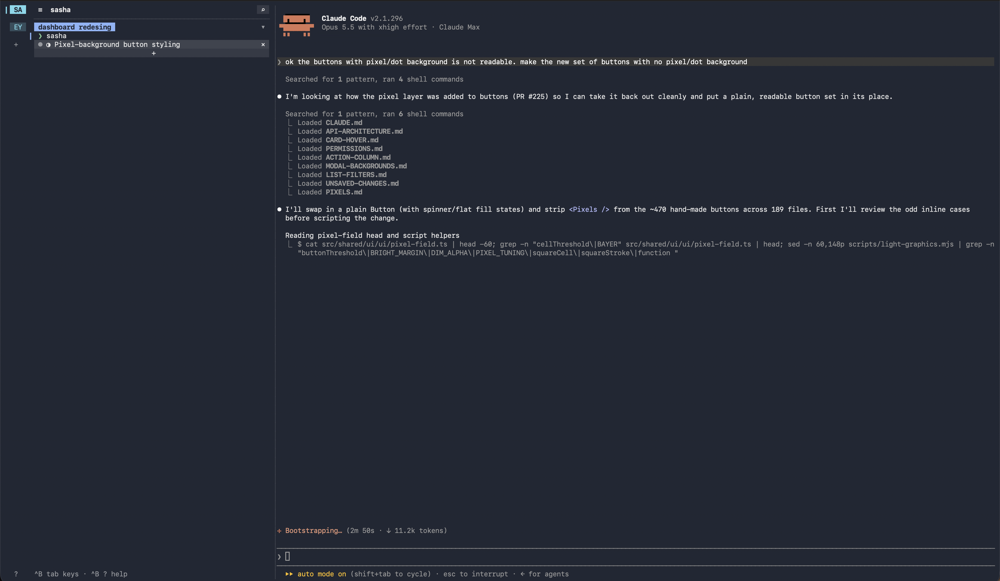

# sasha

[](https://github.com/hasangilak/sasha/actions/workflows/ci.yml)

A terminal with Chrome-style vertical tabs, tab groups and workspaces. Your tabs keep running
in the background, like tmux. Built with [ratatui](https://ratatui.rs), runs inside the
terminal you already use.



## Install

```sh
# Apple Silicon Mac (or sasha-macos-x86_64, sasha-linux-x86_64)
curl -fsSL https://github.com/hasangilak/sasha/releases/latest/download/sasha-macos-arm64.tar.gz | tar -xz
sudo mv sasha /usr/local/bin/
```

Or with Rust: `cargo install --git https://github.com/hasangilak/sasha`

## Use

Run `sasha` in a project folder. Press `Ctrl+B`, then a key (`Esc` goes back to typing):

| Key | |
|---|---|
| `t` | new tab |
| `j` `k` | next / previous tab |
| `h` `l` | previous / next workspace |
| `x` | close tab |
| `r` | rename tab |
| `p` | pin tab |
| `m` | add tab to a group |
| `z` | collapse / expand group |
| `w` | switch workspace, or add a folder |
| `/` | search tabs |
| `d` | detach: tabs keep running |
| `C` | keep the computer awake (☀), or let it sleep (☾) |
| `P` | open pull requests and their diffs (needs `gh`) |
| `O` | ports your tabs listen on; `x` `x` force-kills |
| `F` | browse the terminal's folder: arrows, `⏎` reads a file, `e` edits it |
| `T` | the tower: an agent steering every terminal (`T` again hides it) |
| `i` | show / hide the ports and pull request bars |
| `q` | quit |
| `?` | every key |

The mouse works too: click and drag tabs, double-click to rename, right-click to pin, click a
link to open it, and drag any bar's edge to resize it. The header across the top shows the
terminal you're in above it (click its title to rename, pin, group or close it). The tab sidebar
and each bar that shows have their toggle on top of them; hidden ones line up on the right with a
new terminal and `⋮` for everything else.

## What it does

- **Workspaces** sort terminals by folder: a workspace lists every terminal in its folder
  (`cd` into another workspace's folder and the terminal moves there), and the sidebar stacks
  every workspace that has terminals open.
- **Groups** sort them by task: a named, coloured, collapsible set of terminals from any
  folders, listed at the top of the sidebar. Opening sasha shows just the groups; click a
  workspace's badge to bring its terminals in. A group stays, even empty, until you delete it
  (`×` on its header; `+` opens a terminal in it).
- **Sessions that last**: close the window or detach, then run `sasha` again and everything is
  still there. After a restart, your tabs come back as fresh shells.
- **Notifications** when a background tab finishes, rings the bell, or goes quiet. For Claude
  Code and Codex they say what happened, read from the agent's own session log: the gist of its
  answer and how many files it changed, or the command waiting for your OK.
- **Pull requests**: a bar right of the terminal lists the open PRs of the tab's repo (↻
  refreshes). Open one to see each file marked added, modified or deleted, with its diff. Needs the
  [GitHub CLI](https://cli.github.com), signed in.
- **Files**: a bar right of the terminal shows the folder the active terminal is in as a tree
  (it follows `cd`, and switches with the terminal), with changed files marked as git sees
  them. Click a file to read it over the terminal, in colour for Rust, Python, Go, JavaScript,
  TypeScript, shell, CSS, HTML, JSON, YAML, TOML, Dockerfiles and Markdown, or press `e` to open
  it in your `$EDITOR` in a new tab. `×` hides the bar; `Ctrl+B F` brings it back.
- **Ports**: a slim bar lists what the programs in your tabs listen on; click one to see which
  tab runs it, jump there, or force-kill it.
- **Keep awake**: click ☾ at the top of the workspace bar (☀ while it's on) and the computer
  won't sleep, hibernate or turn off and lock its screen, even with the window closed. It stays
  on across restarts until you switch it off.
- **Your terminal's colours**, transparency included.

## The tower

`Ctrl+B` then `Shift+T` (or ♜ in the header) opens the tower: an agent in a panel at the right
edge, with every terminal in sasha as its tools. Ask it what your sessions are doing, hand a task
to the Claude Code in one terminal and a review to the Codex in another, and it types the
prompts, waits for them to finish, answers their menus when you say so, and comes back with the
results. It can open terminals for new work and bring one on screen for you.

Once opened it keeps running and starts with sasha: ♜ hides and shows the panel (it lights up
when the hidden tower has news), and a click on the tower or the pane says where your keys go.
Drag its edge to resize it.

It runs on your Claude plan or your ChatGPT one. Click its name above the panel to switch, or to
restart it; each picks up its own last conversation.

- **Claude**, the default, runs [Claude Code](https://claude.com/claude-code) itself, so it uses
  your Claude plan's limits. Third-party harnesses signed in to a Claude plan are billed as extra
  usage instead.
- **Codex** runs [pi](https://pi.dev), the coding-agent harness, signed in to your ChatGPT plan.
  The first time, sasha offers to install it (`npm install -g @earendil-works/pi-coding-agent`);
  sign in inside the tower with `/login`, then *ChatGPT Plus/Pro (Codex)*.
- `SASHA_TOWER_CLAUDE_MODEL` and `SASHA_TOWER_CODEX_MODEL` pick the models (Claude Code's own
  default, and `openai-codex/gpt-6.1-sol`).

**Its role.** The tower works as your engineering lead for the agents: it splits a goal into
workstreams, picks or opens a session for each (named after its job, Claude Code by default,
Codex for second opinions), briefs each fully with a definition of done, keeps them out of each
other's files, acts on every finish, approval, question or failure, and brings you the big
picture and only the decisions that are yours. On Claude it hands each session to a
`session-handler` subagent of its own, several in parallel: the handler sends the brief, waits,
approves routine steps, checks the result against the brief and reports back, so the tower's
conversation stays on the plan. **Edit its role** in its menu opens `role.md`,
where your own instructions go ("Codex reviews, Claude Code builds", "report in Persian");
they win where they differ, from the tower's next start.

**It keeps track of its sessions.** sasha remembers what the tower set each terminal to do and
how that's going (working, waiting for approval, done, ended), across restarts, and marks them ♜
in the sidebar, coloured by state. Agents the tower starts are named after their job, in the
sidebar and in Claude Code's own session list, and report through hooks the moment they finish or
stop for an approval. That news reaches the tower at the start of its next turn, or right away
with **auto-reply** on (in its menu), so it can act on it and tell you. The header counts what it
hasn't heard yet.

**It talks back.** Ask the tower to tell you, or for the big picture of everything or of one
session, and it says a short summary aloud (its `speak` tool). With **voice replies** on (its
menu) it says the gist of every answer. `sasha voice install` sets up
[Kokoro](https://huggingface.co/hexgrad/Kokoro-82M), a natural neural voice that runs on your
Mac (it needs `uv`): a small speaker process keeps it loaded, so it starts talking in a fraction
of a second. Pick its voice by name in `~/.config/sasha/voice/voice` (`af_heart` by default;
`bm_george`, `am_michael`, `bf_emma`…). Put `chatterbox` in `~/.config/sasha/voice/engine` and it
speaks with feeling: [Chatterbox](https://github.com/resemble-ai/chatterbox) copies that voice
(from a recording Kokoro makes once) and the tower gives each part of what it says a tone, from
calm to urgent, changing within a message when the news does. It talks a tenth slower than the
model would, with a breath after each sentence; set your own pace in `~/.config/sasha/voice/pace`
(`0.85`, or `1` for the model's own).

**Call its voices by name.** List voices in `~/.config/sasha/voice/people.json`, by name, each
with its model voice, `engine` (`kokoro` or `chatterbox`), and optionally `pace` and `about`:

```json
{
  "bella": {"voice": "af_bella", "engine": "kokoro", "about": "American, bright and clear"},
  "fable": {"voice": "bm_fable", "engine": "chatterbox", "about": "British, warm and expressive"}
}
```

Then "hey Bella, tell me about the open PRs" or "Fable, what's been pushed to main?" brings that
voice up: the tower answers in it, and keeps it until you call the other. Without Kokoro it uses your Mac's
system voice.
Talk to it with Claude Code's or Codex's own voice input.

**Sessions talk to each other.** Each agent the tower starts can see the others by name, read what
they did, and message them or the tower; a message waits until its reader's turn is over. The
tower follows every exchange in its news.

Its tools come from `sasha mcp`, an MCP server you can give any agent: `list_terminals`,
`read_terminal`, `agent_report` (what Claude or Codex last did, from its log), `send_prompt`,
`send_keys`, `wait_for_terminal`, `wait_for_any`, `open_terminal`, `rename_terminal`,
`show_terminal` and `close_terminal`.

## More

Use another prefix with `sasha --prefix ctrl-a`. Turn notifications off with `SASHA_NOTIFY=0`.

## License

[MIT](LICENSE)
